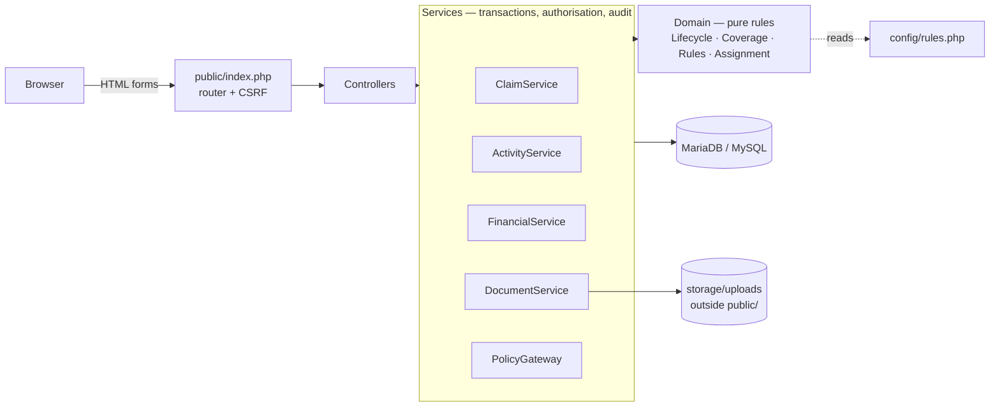
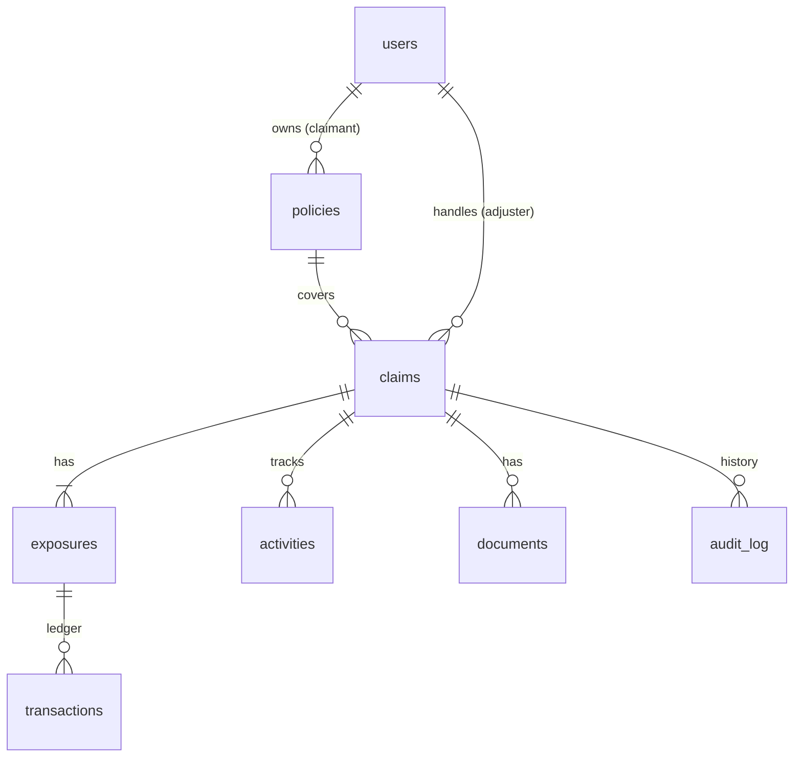
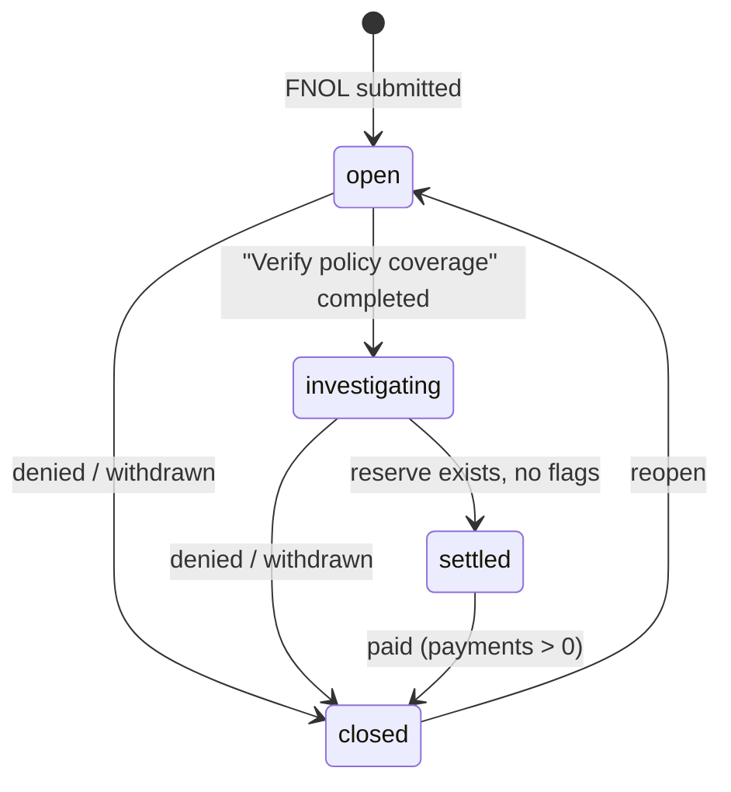

# AVIC — design notes

## 1. Architecture



Layers only call downward. **Controllers** parse input and choose a page; **services** own every
business operation (each runs in one transaction and writes the audit log); **domain** classes hold
rules that need no database and are unit-tested in isolation. Changing a business rule normally means
editing `config/rules.php`, not code.

`PolicyGateway` is the seam to the policy system. ClaimCenter asks PolicyCenter for a policy by number;
here `LocalPolicyGateway` answers from a `policies` table. Swapping in a real integration touches that one class.

## 2. Data model



* **Money** is `BIGINT` whole shillings (UGX has no minor unit) — sums are exact, no floats anywhere.
* **`transactions`** is the ledger. A database `CHECK` guarantees payments/recoveries are positive and no row is zero.
* **`claims.flags`** is a JSON list of intake questions (cancelled policy, loss outside the period, possible duplicate).

## 3. Claim lifecycle



`ClaimService::transition()` locks the claim row (`SELECT … FOR UPDATE`), checks `ClaimLifecycle`, then
applies the guards for the target:

| To | Guard |
|---|---|
| settled | total reserve > 0, no unreviewed flags |
| closed | outcome required: *paid* only from settled and only with payments; *denied/withdrawn* only when nothing was paid |

Closing also releases any unused reserve (an offsetting ledger row), closes the exposures and skips open
activities. Reopening restores the exposures and creates a *Review the reopened claim* activity.
Two adjusters racing on the same claim cannot both win — the second waits on the lock, then sees the new status.

## 4. Financial ledger

```
available reserve (per exposure) = Σ reserve rows − Σ payment rows
```

* **Reserve**: the adjuster sets the *total* reserve for an exposure; the ledger stores the signed difference.
  It can't go below what was already paid, and total reserves can't exceed the policy limit.
* **Payment**: refused unless the claim is *investigating/settled*, has no open flags, the exposure is open,
  and `amount ≤ available reserve` (plus total payments ≤ policy limit).
* **Recovery**: money back in (subrogation, salvage). Informational — it never refills a reserve.
* Rows are never updated or deleted. A correction is a new row, and every movement is also in `audit_log`.

## 5. Rules as data (`config/rules.php`)

* **Assignment**: ordered rules, first that finds an eligible adjuster wins; least open claims breaks ties.
  No match → unassigned queue (any adjuster can *Take this claim*).
* **Activities**: templates keyed by event with optional filters (loss type, exposure type, flagged).
  `on_complete` can move the claim (`verify_coverage` → investigating) or clear flags (`review_flags`).
  Mandatory activities cannot be skipped.
* **Coverage** (`CoverageCheck`): cancelled policy or loss outside the period → *flag* (the claim is still
  accepted, as in ClaimCenter); third-party policies reject *own-vehicle* exposures outright.

## 6. Deliberately left out

Scope was cut to keep the core engine solid and explainable:

* A *garage/vendor* login, notifications, and password-reset e-mail (no mail server in scope).
* Supervisor roles and payment-authority limits — the natural next step: add `users.authority_limit`
  and a `pending_approval` payment state.
* Litigation, subrogation workflows, fraud scoring beyond the duplicate check, deductibles.
* Claim notes, comments and a document viewer for PDFs inside the page.
* A JSON API / OpenAPI description — services are already framework-free, so a thin `/api` controller layer
  over `ClaimService`/`FinancialService` would expose the same operations.
