AVIC single-insurer claims pilot — implementation roadmap

Prepared 18 November 2026 against master at bef222f. Target confirmed: a pilot for one insurer. This is a proposed delivery plan; it does not authorize production deployment, external payments, or changes to insurer policy rules.

**Product direction**

Develop AVIC into a controlled motor-claims operating system for one insurer, retaining the claimant, adjuster and garage experiences. Add the staff controls, financial records, operational workflows and integrations needed to run real claims reliably.

Guidewire ClaimCenter describes end-to-end claims handling, assignment, role-based work and integrations. Duck Creek Claims describes configurable workflows, reserves and payments. These are useful functional benchmarks; matching their complete commercial scope is outside this pilot. [Guidewire ClaimCenter](https://www.guidewire.com/products/core-products/insurancesuite/claimcenter-claims-management-software), [Duck Creek Claims](https://www.duckcreek.com/product/claims-management-software/).

Start with one agreed motor product, one operating team and a small approved garage panel. Prefer repairable own-damage claims as the first live journey. Intake must still capture and refer out-of-scope losses; the system must not incorrectly imply that those losses are rejected. Confirm this product boundary with the insurer in the first milestone.

Defer multiple insurers, additional countries, comprehensive policy underwriting/billing, complex bodily injury and litigation, reinsurance administration, catastrophe operations and automated claim decisions. Real payments remain disabled until finance controls and reconciliation pass acceptance. An independently controlled manual payment process is an acceptable first pilot mode.

**What the current repository already provides**

| Capability | Verified starting point | Pilot improvement |
|---|---|---|
| Customer and staff access | Claimant, adjuster and garage roles; server sessions, CSRF and access checks | Permissions by action and team, supervisor/finance/auditor roles, staff MFA and account lifecycle |
| Claim intake | Drafts, policy-linked claims, uploads and duplicate-incident checks | Versioned policy snapshot at loss, parties, coverage items and duplicate review |
| Claim handling | Assignment on submission, decisions, requested documents and notifications | Activity work plans, supervisors, service targets, escalations, holds and controlled reopening |
| Garage work | Work orders, estimates and estimate decisions | Versioned line-item quotes, supplements, repair authorization, invoices and completion evidence |
| Settlements | Claimant acceptance/dispute and confirmed payee details | Versioned offers, approval limits and independent payment release |
| Payments | One payout per claim, processing/completed states and external evidence | Multiple payments per claim, financial subledger, reversals, integration and reconciliation |
| Complaints | Independent adjuster review; payment/closure hold | Dedicated complaint case management, reasoned outcomes, escalation and reporting |
| Audit and quality | Audit/status history, SQL migrations, PHP/browser tests and CI | Tamper-resistant audit retention, deployment controls, restore drills, monitoring and load tests |

Important code constraints to address deliberately:

- `config/api/policies.php` allows adjusters to issue cover. For the pilot, policy authority must come from the insurer's policy system or an explicitly delegated policy-administration permission. Claims staff must not create coverage to validate their own claim decisions.
- `config/api/policy-rules.php` checks the current policy and a simplified shared coverage limit. Introduce policy versions effective at the loss date, coverage-specific limits and insurer-approved deductible/excess rules. A policy expiring after the incident must not alone invalidate an otherwise covered historical loss.
- `database/migrations/0002_payout_integrity.sql` enforces one payout per claim. Multiple payees, installments, expenses and corrections require a new financial model and an explicit migration of that invariant.
- `config/api/payouts-update.php` currently requires the approving adjuster to advance payment. Replace that rule with separate claim approval and finance release permissions, including a prohibition on self-approval where the insurer requires two people.
- `config/api/claim-state.php` treats closed claims as terminal. Add authorized reopening with a reason and retained historical decisions.
- `bootstrap.php` sends role-scoped collections to the browser. Preserve its access boundaries while moving larger lists to paginated, filtered endpoints.
- Database money fields use DECIMAL, but PHP calculations also use floats. Standardize exact money handling before extending financial calculations.

**Target operating journey**

```mermaid
flowchart LR
    A[Report loss] --> B[Validate policy at loss and triage]
    B --> C[Assign owner and work plan]
    C --> D[Investigate and assess exposures]
    D --> E[Set reserves and review coverage]
    E --> F[Approve and offer settlement]
    F --> G[Record acceptance where required]
    G --> H[Independent finance authorization]
    H --> I[Execute or record payment]
    I --> J[Reconcile and close]
    J --> K[Authorized reopening if necessary]
    K --> D
```

An exposure is a distinct item or liability within a claim, such as damage to the insured vehicle or a third party's property. Each needs its own coverage decision and financial history. Documents, tasks, complaints and recovery work run alongside the claim lifecycle rather than becoming dozens of mutually exclusive claim statuses.

Retain existing customer-visible statuses during migration. Internally track claim state, exposure state, document requests, settlement state and payment state separately. Publish an explicit mapping to customer-facing status and next action.

**Delivery sequence and release gates**

The ranges below are planning estimates for two experienced developers, shared QA, and regular access to a claims lead and finance representative. They are not delivery commitments. Approximately 17–25 calendar weeks is a starting envelope with that staffing; supplier access, insurer decisions and data cleanup can extend it. Re-estimate after discovery and the first implementation milestone.

| Phase | Indicative duration | Outcome | Exit gate |
|---|---:|---|---|
| 0. Agree the operating model | 1–2 weeks | Product scope, process, authority matrix, data inventory and pilot measures | Claims, finance and operations approve example cases and rules |
| 1. Establish the foundation | 2–3 weeks | Modular services, permissions, MFA, staging, exact money and durable jobs | Existing journeys remain green; authorization and recovery checks pass |
| 2. Build the claims workbench | 3–4 weeks | Policy snapshots, exposures, tasks, routing, investigation and reopening | Agreed claims scenarios work end to end with traceable decisions |
| 3. Establish financial control | 4–5 weeks | Reserves, authority limits, settlement versions, multiple payments and reconciliation | Finance signs off balanced reports and duplicate/concurrent payment tests |
| 4. Connect service channels | 3–4 weeks | Policy import/API, notifications, documents, garage workflow and provider sandbox | Integration outages, retries and duplicate callbacks are handled correctly |
| 5. Prove and launch the pilot | 4–7 weeks, partly overlapping phase 4 | Migration rehearsal, security review, training, shadow operation and limited rollout | Named business owners approve evidence and support readiness |

Phase 5's preparation can overlap integration work; its live pilot period cannot precede the financial and security gates. Provider discovery and access requests start in phase 0. Staff screens and customer communication improvements are delivered alongside each workflow, not postponed to a final redesign.

**Phase 0 — specify the insurer's rules before encoding them**

Interview a claims handler, supervisor, finance officer, garage representative and customer-service/complaints owner. Walk through anonymized historical cases: ordinary repair, missing documents, duplicate report, suspected fraud, declined cover, disputed offer, failed payment and reopened claim.

Produce an approved process map, vocabulary, permission/authority matrix, product coverage examples, data retention schedule and exception-handling guide. Record which system owns policy truth, payments and customer identity. Define service targets by activity, the business calendar, pause reasons and escalation recipients; the current configurable 14-day setting must not be treated as a legal deadline.

Confirm policy import quality, payment-provider access, reporting obligations, hosting budget, expected volume and operational support. Define what the pilot explicitly handles and what requires a manual specialist referral. Resolve whether legacy records must be imported or the pilot starts with new claims only.

Acceptance: each representative can explain who owns a claim at every stage, who can authorize money, and how an exception is handled. Record unresolved decisions with an owner and due date.

**Phase 1 — strengthen the existing application incrementally**

Keep PHP and MariaDB. Use a modular monolith: one deployable application with clear modules for identity, policy/coverage, claims, activities, documents, vendors, finance, complaints, audit and integrations. Avoid a wholesale rewrite during pilot development.

Move business rules from endpoint scripts into tested services behind the existing API paths. Introduce centralized request validation, consistent errors, correlation IDs and permissions. Retain transaction boundaries and the existing concurrency tests. Document the API contract; introduce `/api/v1` only when versioning is actually required, with compatibility adapters for existing pages.

Add supervisor, finance, administrator and read-only auditor capabilities. Separate identity from permission grants so one role enum does not become the authorization model. Staff access requires MFA, scoped permissions, audited privilege changes and prompt offboarding. Administrator access must not automatically confer payment authority. Keep claimant ownership and garage work-order restrictions on every backend operation.

Define a Money value type with currency, exact amounts and explicit rounding. Choose integer posting units or decimal strings with exact arithmetic; approve precision with finance and migrate existing two-decimal amounts without silent rounding. Treat dates in UTC for storage and insurer-approved local calendars for deadlines.

Add a database-backed job queue and transactional outbox: business changes and the intent to notify are committed together; workers deliver afterward with retry limits, deduplication and a failed-job queue. This prevents lost messages or notifications sent for rolled-back decisions. Redis is optional if actual throughput later justifies it.

Create isolated development, staging and production configurations, reproducible setup and synthetic test data. Restore a concise README and document the HTTP launcher so opening `index.html` from the filesystem cannot be mistaken for running the application. Establish encrypted backups and exercise restoration early.

Acceptance: existing role journeys pass; cross-user and cross-role access is denied; disabling a staff account takes effect; failed jobs can be retried without duplicate business actions; money calculations are exact; a staging restore works.

**Phase 2 — make the claim a complete operational case**

Add policy versions, coverage snapshots and evidence of verification at intake. Keep a provisional loss report when policy lookup fails, clearly marked for verification; block coverage acceptance and payment until the uncertainty is resolved. Duplicate detection should create a reviewable match where appropriate, rather than refusing every similar incident automatically.

Introduce claim parties, vehicles, exposures, coverage decisions and assessment records. Save rule/version identifiers and reasons so a decision can be reproduced later. Coverage should support the chosen product's limits, sublimits and excess/deductible rules without pretending the same limit applies to every product.

Create task templates triggered by business events: verify coverage, request documents, arrange inspection, review quote, approve settlement, reconcile payment and close. Each task has an owner/team, deadline, priority, status, required evidence and escalation path. Mandatory work cannot be silently skipped. Rules route by skills, geography and workload, with a visible unassigned queue and supervisor override.

Add a claim timeline, internal notes, separately classified customer messages, diary/reminders, investigation flags and an authorized reopen action. Retain existing complaint independence; changing a complaint outcome creates an auditable follow-up decision instead of overwriting the original decision.

Acceptance: a handler can process the approved example cases entirely through the workbench; every open claim has an accountable team; overdue tasks escalate; a closed claim cannot be edited without an authorized reopening; customer accounts cannot see internal investigation notes.

**Phase 3 — implement a claims financial subledger**

Separate an estimate, a reserve, an approved settlement, a payment instruction and a confirmed payment. They are different records with different authorities. A reserve represents expected outstanding liability; it is not proof of payment.

Introduce immutable financial entries for reserve changes, payments, reversals and recoveries, linked to claim, exposure, coverage, currency and actor. Corrections use linked compensating entries. Keep indemnity, expenses and recoveries distinguishable. Define how partial payments reduce outstanding reserves, how reopening affects reserves, and which policy limits aggregate across claims. Finance owns the accounting/export mapping; this is a claims subledger, not a replacement for the insurer's general ledger.

Add configurable approval limits and independent payment release. Changes to amount, payee or settlement terms invalidate approvals/acceptance as appropriate and require fresh authorization. Recheck authority at release, including changes to staff permissions. Store payee-change history and restrict bank/mobile-money details.

Support multiple payment instructions and recipients per claim. Use unique idempotency keys, stable provider references and row locking to prevent repeat requests or concurrent staff actions from paying twice. Keep failed, unknown, pending, confirmed and reversed outcomes distinct. A timeout means unknown until reconciled; it must not trigger a blind new payment.

Reconcile provider/bank records against instructions and ledger entries. Exceptions belong to a finance queue with evidence and an owner. Never mark a payment successful solely because the initial API request was accepted. Support authorized manual recording with uploaded evidence and independent confirmation when no live provider integration is available.

Extend complaints with category, acknowledgment, ownership, review deadlines, appeal/escalation and a decision record. Have the insurer approve which disputes block which payments, including treatment of undisputed amounts. Give customers an escalation route; Uganda's IRA describes external complaint escalation for dissatisfied claimants. [IRA complaints guidance](https://ira.go.ug/helpie_faq/what-if-the-insurance-company-declines-to-pay-my-claim/).

Acceptance: duplicate requests/callbacks create no duplicate payment; concurrent actions cannot overspend authorized amounts; limits and separation of duties are enforced; ledger totals reconcile with external statements; historical entries cannot be edited through application or ordinary database credentials; unresolved financial exceptions block inappropriate closure.

**Phase 4 — integrate the insurer and service partners**

Prioritize a policy adapter first, then reliable email/SMS, then finance integration. Start with approved CSV imports or sandbox APIs when partners are unavailable, and label simulated outcomes clearly. Production payment credentials are not a prerequisite for functional development.

Define interface contracts for authentication, versioning, timeouts, idempotency, callback signature validation, replay detection and status reconciliation. Keep credentials outside Git and personal data out of diagnostic logs. Queue long-running provider calls and expose delivery/processing failures to staff.

Upgrade document handling with private storage, malware quarantine, checksums, versions, classification, access logs and limited-duration download authorization. A file must not be downloadable while awaiting a required malware scan. Preserve original evidence and restrict redaction/export operations.

Keep garages as real users: manage approved suppliers, versioned line-item estimates, supplements requiring fresh authorization, repair progress, invoice matching and completion evidence. The scope of a garage's document and personal-data access follows its assigned work.

Deliver a focused workspace for each participant:

| User | Main working view |
|---|---|
| Claimant | Report loss, requested documents, understandable status/next step, offer response, payment updates and complaints |
| Adjuster | Prioritized queue, case timeline, coverage/exposures, assessments, tasks and proposed decisions |
| Supervisor | Workload, overdue work, escalations, authority approvals, reassignments and reopen requests |
| Finance | Authorized payment queue, payee verification, reconciliation and exceptions |
| Garage | Assigned jobs, quote versions, repair authorization, progress and invoices |
| Auditor/administrator | Read-only audit/reporting, or separately permissioned configuration and access management |

Replace large bootstrap payloads with paginated lists and server-side filters. Keep mobile layouts, keyboard navigation, clear field errors and low-bandwidth behavior. Save drafts safely and distinguish a successful submission from a locally saved draft.

Acceptance: an unavailable provider does not lose a claim; resumed workers recover safely; tampered/replayed callbacks are rejected; a keyboard-only user completes document submission; uploads and notifications have observable outcomes; garage invoices cannot exceed authorized work without a recorded supplement approval.

**Phase 5 — prove operational readiness and run a limited pilot**

Map applicable controls to OWASP ASVS 5.0.0 Level 2, with stronger review for financial authorization and privileged access. Treat this as an evidence-backed verification target, not certification by assertion. Include dependency scanning, secret scanning, authorization tests, upload attacks, concurrency tests and an independent security review. [OWASP ASVS](https://asvs.owasp.org/).

Have the insurer's compliance/privacy owner confirm applicable Uganda requirements, registration/reporting responsibilities, privacy notices, lawful processing, retention, access requests, incident handling and cross-border processor arrangements. Use current IRA and PDPO materials; do not hardcode deadlines from assumptions. [IRA regulatory circulars](https://ira.go.ug/circulars/), [Uganda PDPO](https://pdpo.go.ug/).

Make audit events append-only for the application database user, with restricted administration and independent retained exports or immutable storage. Record actor, action, reason, record version and correlation ID; redact credentials and unnecessary sensitive values. A normal audit table alone is not tamper-proof.

Rehearse legacy migration: inventory sources, map fields, preserve identifiers and attachments, backfill policy/exposure relationships, reconcile counts and money, review exceptions, and obtain sign-off. Do not fabricate missing historical approvals or treat manually recorded payment as a provider-confirmed transfer. Use a cutover window or controlled incremental import with a single writer. Preserve original data and a tested recovery path.

For schema changes use new numbered migrations and an expand/backfill/switch/retire sequence; never edit applied migrations. Test upgrades from the current database as well as clean installations. Roll back application releases where compatible; reconcile or forward-fix committed financial activity rather than pretending external payments can be undone by restoring the database.

Run shadow processing on a proposed 20–50 anonymized or properly authorized cases, including agreed exception scenarios, before granting operational authority. Then run a limited live pilot with named users, exposure/payment limits and daily review. Confirm the sample size with the insurer; it is a planning proposal, not a statistical guarantee.

Monitor structured errors, request latency, queue age, failed deliveries, overdue activities, payment mismatches and access anomalies. Assign support and incident owners, alert thresholds and escalation contacts. Train each role and conduct a restore/incident exercise.

Proposed pilot gates, to ratify in phase 0:

| Area | Measurable evidence |
|---|---|
| Workflow | Every approved core/exception scenario passes; every open claim has an owner/team and next action |
| Finance | No unexplained reconciliation difference; zero duplicate payments in retry/race scenarios; every release has valid authority |
| Security | No unresolved critical/high findings; agreed ASVS controls evidenced; staff MFA and data-scope tests pass |
| Performance | On an agreed 10,000-claim dataset with 50 concurrent users, ordinary paginated API reads have p95 below 1 second, excluding external providers |
| Recovery | Demonstrated recovery-point objective of 15 minutes and recovery-time objective of 4 hours, subject to hosting budget and insurer approval |
| Operability | Alerts reach a named owner; failed jobs can be replayed safely; recovery and cutover runbooks have been exercised |
| Business benefit | Establish baseline median/90th-percentile cycle time, overdue-task rate, complaint aging and payment-exception rate; agree improvement targets after observing baseline |

These are proposed targets, not measured properties of today's AVIC. A green CI run is necessary but insufficient for live insurer use.

**Implementation map and dependencies**

Introduce services incrementally under `src/`, while existing `config/api/*.php` files remain compatibility entry points. Keep frontend behavior stable during extraction. Modules own their business rules and transactions; background workers invoke the same services as HTTP handlers.

Proposed additive entities: permission grants and teams; policy versions/coverage snapshots; claim parties and exposures; activity templates/tasks; assessment and decision versions; reserve/financial entries; settlement versions and acceptances; payment instructions/attempts/reconciliation items; document versions; vendor quote/invoice versions; outbox/jobs; complaint events. Final names and normalization belong to the design milestone.

Dependency order: permissions and exact money precede financial authority; policy snapshots and exposures precede coverage-specific reserves; financial controls precede payment connectors; durable jobs precede reliable notifications/callback processing; operational recovery and acceptance precede live cases. Reporting starts with each module, not after rollout.

Keep `master` as the sole permanent branch, following the repository preference. Deliver small, tested commits and release tags; use disabled feature flags and backward-compatible migrations for incomplete capabilities. If temporary review branches are later allowed, delete them immediately after merge. This plan itself creates no branches, GitHub issues or deployment changes.

**First implementation milestone**

Begin with a bounded foundation slice, not a dashboard overhaul:

1. Approve one repair claim journey plus missing-document, disputed-offer and failed-payment exceptions.
2. Write the action-level permission and financial-authority matrix; specify the transition from the current three-role enum.
3. Restore setup/architecture documentation and prove a clean staging installation and current-database upgrade.
4. Extract claim transitions into a service without changing current behavior; retain and extend lifecycle/access regression tests.
5. Add exact money handling and characterize existing values before any financial schema migration.
6. Deliver the first task queue: coverage-verification tasks, owner, due date and supervisor visibility.

Success for this milestone means a handler and supervisor can explain and complete one controlled case, with tests protecting the existing claimant and garage flows. Production financial authority remains a later gated milestone.

**Later expansion**

After the pilot demonstrates stable handling and reconciliation, extend to total loss, theft, salvage and recovery/subrogation workflows; broader third-party and injury claims; more products and branches; stronger fraud referral and analytics; and additional payment channels. Add AI document extraction or summaries only with source references, access controls and human verification. Automated denials or payment release require a separately approved governance and validation programme.
